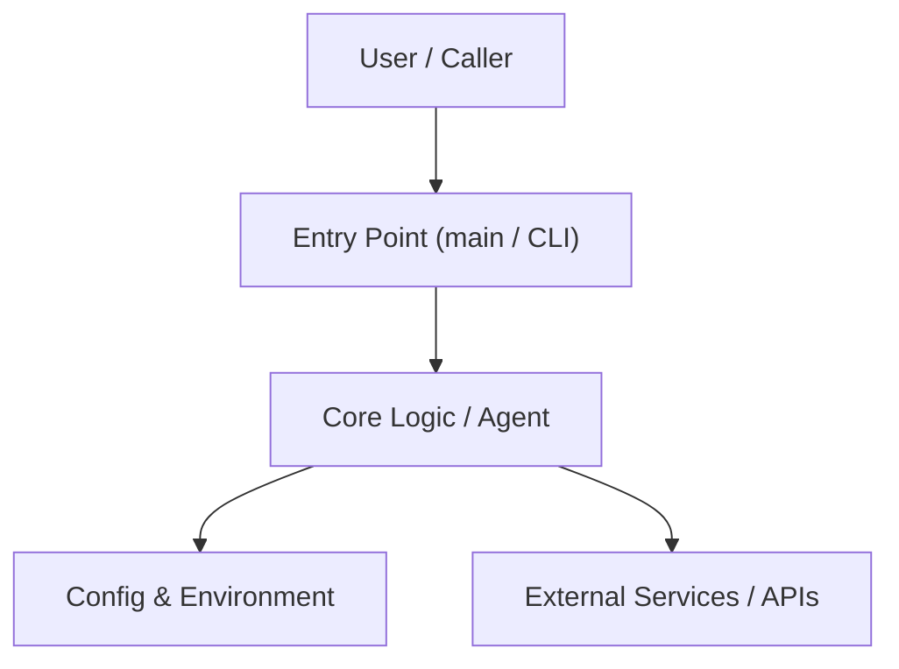

# Architecture: {{project_name}}

## Overview
{{project_description}}

## System Components

## Directory Structure
- `src/{{package_name}}/`: Primary source code and domain logic.
- `tests/`: Automated unit and integration tests.
- `docs/`: Architecture diagrams, guides, and specifications.

## Data Flow & Invariants
1. Configuration is loaded from environment variables (`.env`).
2. Core modules maintain strict separation of concerns with type annotations.
